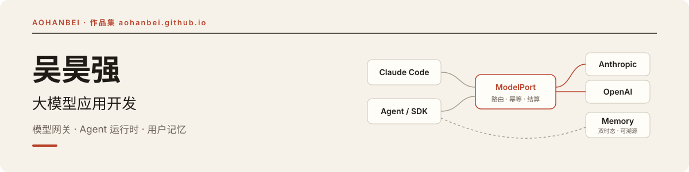

<picture>
  <source media="(prefers-color-scheme: dark)" srcset="assets/banner-dark.svg">
  <source media="(prefers-color-scheme: light)" srcset="assets/banner.svg">
  
</picture>

  
  
  

## 你好，我是吴昊强

做模型网关、Agent 运行时与用户记忆的大模型应用开发，2027 届，正在找大模型应用开发岗位。

[精选项目](#精选项目) · [开源贡献](#开源贡献) · [技术方向](#技术方向) · [作品集](https://aohanbei.github.io/)

## 精选项目

<table>
  <tr>
    <td width="50%" valign="top">
      <h3><a href="https://github.com/AoHanBei/ModelPort">ModelPort</a></h3>
      
源于实习的大模型网关，为 Claude Code、OpenAI SDK 与内部 Agent 提供统一调用入口：协议适配、确定性路由、并发幂等与预算结算。

      

        
        
      

    </td>
    <td width="50%" valign="top">
      <h3><a href="https://github.com/AoHanBei/Memory">可演化用户记忆</a></h3>
      
面向长期 AI 助手的用户记忆服务，记忆可溯源、可回看、可受控更新：双时态查询、混合检索归因、反馈隔离与策略发布门禁。

      

        
        
      

    </td>
  </tr>
  <tr>
    <td width="50%" valign="top">
      <h3><a href="https://aohanbei.github.io/projects/quantpilot.html">量化研究智能体</a></h3>
      
学习笔记（原项目 QuantPilot）：把自然语言金融研究变成可交付任务的 Data Agent，关注领域包、Worker 治理与独立质量门禁。

      

        
      

    </td>
    <td width="50%" valign="top">
      <h3><a href="https://github.com/AoHanBei/aohanbei.github.io">个人作品集</a></h3>
      
Vite + React + TypeScript 多页面站点，项目文案逐条对应事实来源并在 CI 中校验，GitHub Actions 自动部署。

      

        
        
      

    </td>
  </tr>
</table>

## 开源贡献

围绕 Agent 运行时与模型调用链路的可靠性提交修复与增强，每条都附带回归测试。

| 上游项目 | Stars | 已合并 PR | 代表性改动 |
| --- | --- | --- | --- |
| [DeerFlow](https://github.com/bytedance/deer-flow) | 85k+ | 5 | [#4933](https://github.com/bytedance/deer-flow/pull/4933) MCP 远程任务取消补偿，保留原始取消语义 [#5127](https://github.com/bytedance/deer-flow/pull/5127) 持久化循环检测事件，补齐子 Agent 审计转发 |
| [DeepTutor](https://github.com/HKUDS/DeepTutor) | 55k+ | 8 | [#1499](https://github.com/HKUDS/DeepTutor/pull/1499) 重试预算随密钥池伸缩，限流后剩余密钥都会被尝试 [#1492](https://github.com/HKUDS/DeepTutor/pull/1492) 定价改为精确匹配优先，修复 gpt-4o-mini 成本高估 |

完整清单按主题分组见 [作品集 · 开源贡献](https://aohanbei.github.io/#open-source)。数字核对于 2026-11-06，只统计本人提交并合并到上游的 PR。

## 技术方向

- **模型接入与 Agent 工程**：模型协议适配、工具调用、SSE 流式处理及 Agent 运行时故障排查。
- **记忆与检索**：长期记忆建模、双时态查询、混合召回、结果归因及固定评测门禁。
- **后端可靠性**：PostgreSQL 事务、请求幂等、租约协调、异步任务取消与生命周期管理，结合回归测试分析并发与一致性问题。
